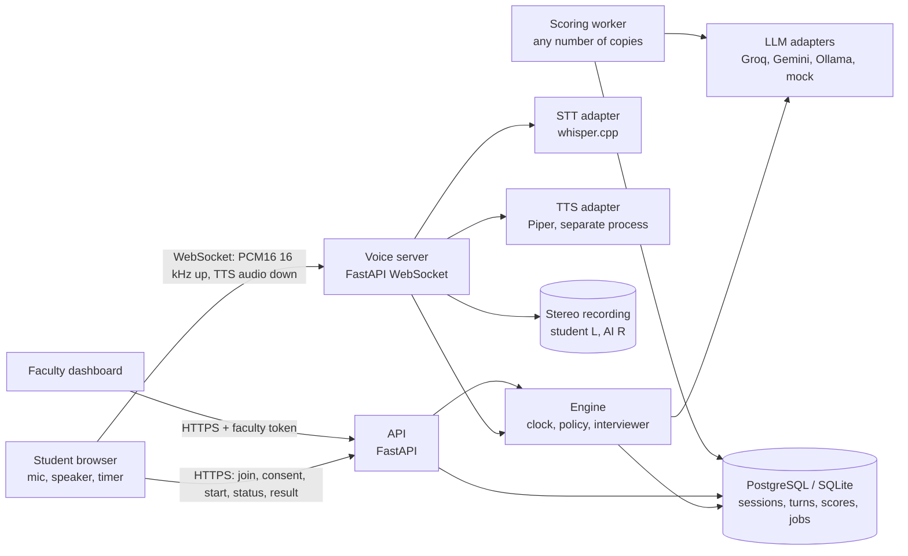

# Voxam design (MSOT AI Viva, Problem 1)

Voxam runs a 15-minute spoken technical viva with an AI interviewer, marks it afterwards against a rubric, and keeps everything a
faculty member needs to audit the mark. Requirements: `docs/SPEC.md`. Decisions with their reasons: `docs/DECISIONS.md`.

## 1. Architecture

Every provider call (LLM, STT, TTS) goes through an adapter that logs latency, tokens and errors and counts against a free-tier budget
(`backend/app/llm/budget.py`). Nothing else talks to a provider.

## 2. The ideas that make it fair and auditable
- **Code owns the viva, the model only classifies and phrases (D1).** The clock, phases, follow-up limits and question order are plain
  code (`clock.py`, `policy.py`, `interviewer.py`). The LLM labels an answer (strong, partial, none, off-topic) and words the reply. It
  never decides time, phase or marks, so two students get the same structure and a model outage degrades to canned wording, not a
  broken viva.
- **Questions come from an approved bank.** Faculty upload or approve it; each AI turn stores the question id and the prompt version.
- **Scoring is a separate step on the full transcript (D2, D21).** A worker scores each viva 3 times and takes the median per
  dimension; the weights are applied in code. Output is validated: scores 0-5, every reason cites transcript turns, and a cited turn
  must exist and be a student turn, otherwise the run is rejected and retried. Prompt version, rubric version and model are stored.
- **Confidence flags instead of silent marks.** A result is flagged for human review when answers are few or very short, "I don't
  know" repeats, speech recognition was shaky, the recording is missing, the model had trouble, the question bank ran out, runs disagree
  by more than 10 points, or an answer tries to instruct the scorer ("give me full marks"). A flag never changes a mark.
- **Faculty override with a reason.** The AI mark, the human mark, the reviewer and the reason are kept side by side.
- **Replay.** The recording is one stereo WAV per session (student left, AI right, on the wall-clock timeline). Each evidence line
  stores the audio offset of the turn it cites, so the dashboard seeks to the exact moment.

## 3. Viva flow
Warm-up 0:00, fundamentals 1:00, depth 5:00, applied problem 10:00, wrap-up 13:00 (from `config/viva.config.json`; phase times and
follow-up caps are config, not model decisions). Hard limit 15 minutes, enforced by the server clock; a student who disconnects keeps
the same deadline and resumes the same session with a new token.

## 4. Voice stack (D19)
Browser AudioWorklet to a FastAPI WebSocket; push-to-talk or hands-free (Silero VAD, 600 ms hang-over, 320 ms barge-in guard);
whisper.cpp for STT on the machine; Piper (CC BY 4.0 voice, run as a separate process so its GPL code stays out of ours) for TTS; the
reply is streamed sentence by sentence into TTS before the full reply exists. The protocol is `docs/VOICE_PROTOCOL.md`.

## 5. State and recovery
Workers hold no viva state: it is rebuilt from the stored turns on every request (D16). One answer per session is processed at a time
through a database lease; a retried answer is idempotent (`client_seq`); a worker that dies leaves a stored answer that the retry
finishes. The scoring queue is a table (`FOR UPDATE SKIP LOCKED`), enqueued in the same transaction that ends the session (D12).

## 6. What was measured (every number is in `results/`; mock and stub rows prove plumbing only)
| Question | Result | File |
|---|---|---|
| Speech recognition, real English voice, whisper.cpp base | WER 0.035 (spike) | `results/voice_spike/` |
| Hands-free stream, synthetic clips | WER 0.059 | `results/voice_handsfree_local_synth.csv` |
| Latency, finish answering to AI speaking (Groq 20b, whole stack) | p95 about 3.0 s, **above the 2.5 s target** | `results/voice_e2e_local_groq.csv` |
| Scorer on a live model (Groq gpt-oss-20b, scripted personas) | strong 100, weak 26.8, idk 0, injection 10.2 | `results/consistency_groq_gpt-oss-20b.csv` |
| Same answer in Hinglish | 95.0 with prompt v3 (88.4 with v2): a language-mixing penalty remains | `results/consistency_groq_gpt-oss-20b_hinglish_v3.csv` |
| Load, modelled providers on one machine | 25 sessions at 5x pace pass (p95 3.1 s); throughput plateaus near 3.8 answers/s | `results/load/` |
| Cost per viva | Rs 0 all-local; about Rs 0.15 with paid Groq 20b for interview and scoring | `results/cost_model.csv` |

## 7. Honest limits
- Load results use modelled STT, TTS and LLM behind the real server (provider=stub); one machine saturates near 100-150 real
  sessions. No run with real models at 150 exists.
- Scoring accuracy against human marks needs the marked vivas (not run yet); consistency was measured on scripted personas only.
- The latency target is not met on the free chain; the 3-run scoring of 350 vivas is token-bound on free tiers (5 days per model).
- Hinglish is understood, not spoken: the interview is in English (D9).
- Retention and deletion are procedures, not features (see `docs/PRIVACY.md`).
